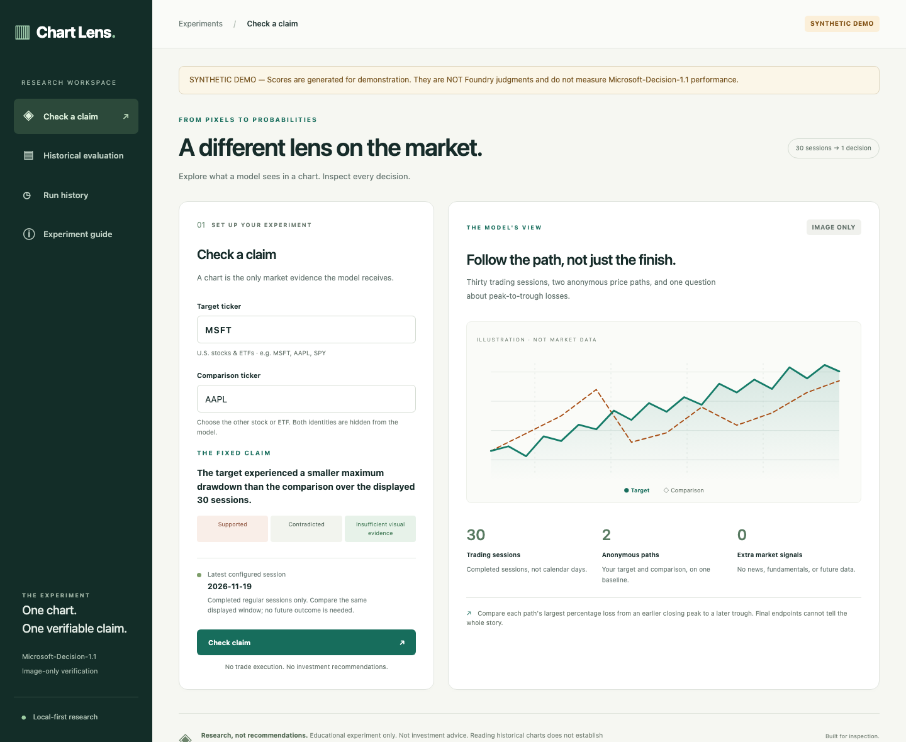
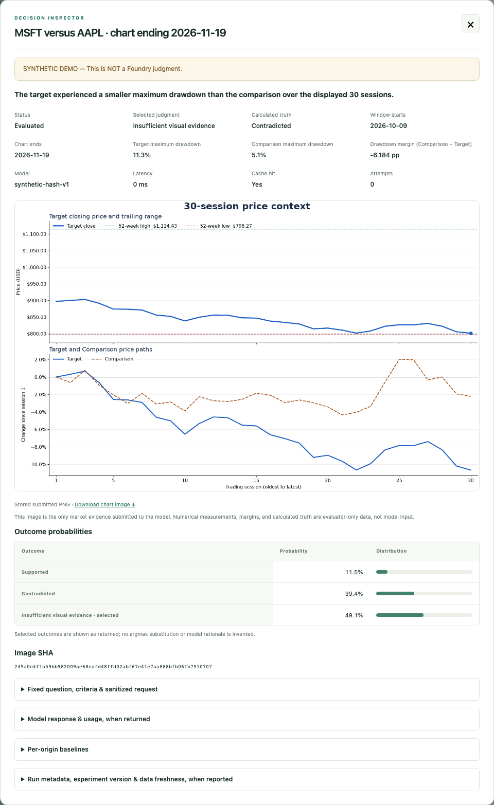
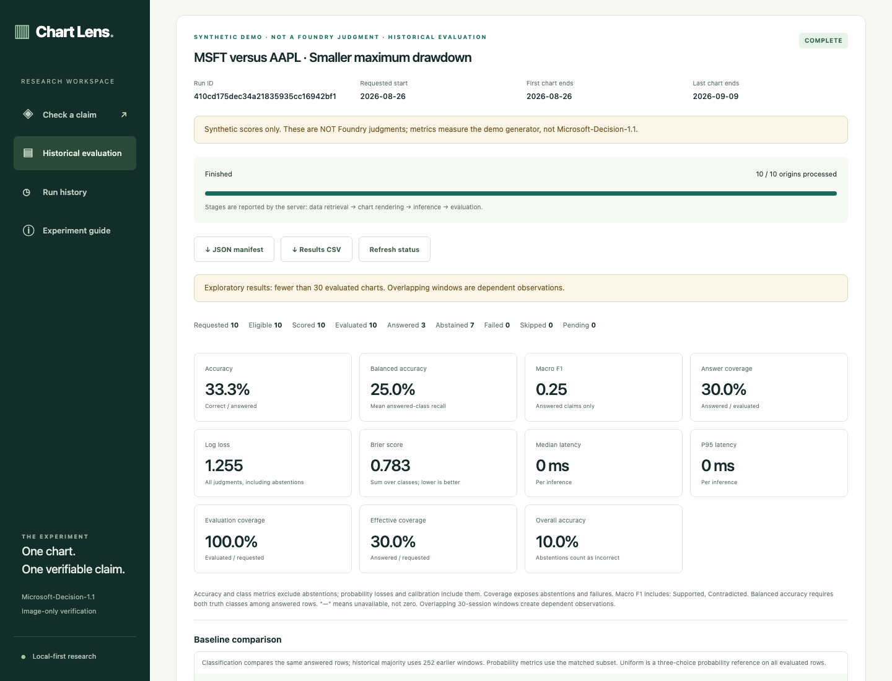

## Chart Lens

**One chart. One verifiable claim. Every decision open to inspection.**

An educational, local-first demo for exploring image-only chart verification
with Microsoft Decision 1.1. Choose two tickers, inspect the anonymous chart
the model receives, and compare its judgment with calculated truth.
The question stays deliberately narrow:

> Did the target experience a smaller maximum drawdown than the comparison
> over the displayed 30 trading sessions?

Maximum drawdown is the largest percentage loss from an earlier closing peak
to a later trough. This tests whether a model can follow a price path, not
predict where prices go next.



[Try it locally](#try-it-locally) · [Take the tour](#a-quick-tour) ·
[Connect a real model](#use-real-data-and-decision) ·
[Understand the results](#interpret-the-results)

### What you can learn

* Explore how a chart becomes an image-only classification task.
* Inspect Supported, Contradicted, and Insufficient visual evidence judgments.
* Compare judgments with numerical truth, baselines, and answer coverage.
* Download the exact chart, run manifest, and per-session results for inspection.

> [!IMPORTANT]
> Screenshots use synthetic demo data and scores, not Foundry judgments.
> They illustrate the workflow, not Microsoft Decision 1.1 performance.
> This is an educational experiment, not investment advice.

## Try it locally

With [uv](https://docs.astral.sh/uv/) installed, run:

```bash
uv sync --python 3.11
CHART_LENS_MODE=demo uv run --no-sync uvicorn chart_lens.app:app --host 127.0.0.1
```

Open <http://127.0.0.1:8000>. Try **Check a claim** with target `MSFT` and
comparison `AAPL`, open the decision
inspector, then use **Historical evaluation** with the suggested start date
and 10 charts.
You can download the exact PNG, run manifest, and per-session CSV. Run history
persists locally; a cancelled historical evaluation can resume under its
original settings.

> [!TIP]
> Start in demo mode to explore the full workflow without live credentials or
> inference charges. It uses synthetic prices and scores, does not call Yahoo
> or Microsoft Foundry, and cannot measure the model's visual judgment.

## A quick tour

### 1. Set up a claim check

Choose a target and comparison, such as `MSFT` and `AAPL`, then select
**Check claim**. The workspace above introduces the fixed question and chart
format. Both ticker identities are hidden from the model.

### 2. Open the decision inspector

Select a session in **Per-session evidence** to see its submitted chart,
selected judgment, and outcome probabilities. Calculated drawdowns and truth
are shown for your evaluation; they are not sent to the model.



An abstention is a result worth inspecting, not a missing answer to hide.
The inspector also exposes the image hash and stored request and response.

### 3. Evaluate more than one chart

In **Historical evaluation**, choose a start date and chart count, preview the
interval and maximum calls, then confirm the run. Review accuracy alongside
answer coverage, probability losses, baselines, and per-session evidence.
Export the JSON manifest or CSV to explore further.



This 10-chart example is exploratory. Its synthetic metrics demonstrate the
report layout only; overlapping windows are not independent observations.
Use **Run history** to reopen your own saved experiments.

## Use real data and Decision

You need an existing Microsoft-Decision-1.1 deployment and an Entra identity
with inference access. Review the [Decision API guide][decision] for setup.
Before enabling live mode, confirm Yahoo's terms permit your intended
retrieval, retention, and processing of the derived chart by Foundry.
[yfinance][yfinance] is unofficial and has no service guarantee.

From the project root, copy [`.env.example`](.env.example) to `.env` if you
don't already have one:

```bash
cp .env.example .env
```

In `.env`, set `CHART_LENS_MODE=live`, `CHART_LENS_ALLOW_YAHOO=1`, and your
`AZURE_ENDPOINT` and `DEPLOYMENT_NAME`. Sign in and start the app:

```bash
az login
uv run --no-sync uvicorn chart_lens.app:app --host 127.0.0.1
```

The app reads `.env` from the working directory at startup. Shell environment
variables take precedence, so the demo command above works even with live
settings in `.env`. Restart the app after editing the file. `.env` is ignored
by Git.

`AZURE_ENDPOINT` is the resource root, not a project URL or a URL ending in
`systemone`. Live inference is billable. Start with one claim check before
running a historical evaluation. The preview shows a worst-case attempt count; cache hits,
ineligible origins, and requests that do not need a retry reduce actual calls.
If you repoint a deployment, update `DECISION_MODEL_REVISION` to invalidate
local inference reuse. A deployment name alone does not guarantee replay.

Keep the server on loopback with one process. It is not a public hosting
configuration. Local artifacts and snapshots are kept in `.chart-lens/`;
`CHART_LENS_DB` can point to a different SQLite file. Use **Run history** to
delete saved runs. No Yahoo key or Finnhub subscription is needed.

## Interpret the results

The chart uses 30 completed regular sessions, historical 52-week extremes,
and two relative-price paths labeled Target and Comparison. Both ticker inputs
are required; there is no fixed-index fallback. Decision selects **Supported**,
**Contradicted**, or **Insufficient visual evidence**. The evaluator calculates
each path's largest percentage decline from an earlier closing peak to a later
trough inside the window, using split-adjusted prices. A strictly smaller target
drawdown supports the claim; ties contradict it. Flat or rising paths have zero
drawdown. Identical tickers are allowed as a tie control.

Unlike endpoint outperformance, this requires following the full path, even if
prices later recover. Loss is measured relative to the earlier peak, not as the
vertical percentage-point drop on the rebased chart. The drawdown margin is
Comparison minus Target: positive supports the claim. No future outcome is needed.

Accuracy and class metrics use answered claims; answer coverage exposes
abstentions. Evaluation coverage also exposes missing or failed judgments.
Overall accuracy counts abstentions as incorrect. Probability losses and the
two-by-three confusion matrix include abstentions. Margin slices distinguish
near-ties from obvious gaps, and baselines use matched answered sessions.
The historical-majority baseline uses 252 earlier 30-session windows only.

Historical runs save each judgment before attaching numerical truth. These
drawdown measurements and labels never accompany the model's image. Data retrieved today can
include revisions, and overlapping windows are dependent. Fewer than 30
evaluated charts are flagged exploratory. Reading a chart correctly does not
establish forecasting or trading ability. This is not investment advice.

Old SPY-outperformance, five-band, and binary forecasting runs remain in **Run history**, labeled
as legacy experiments with their original results and exports. They cannot
resume under drawdown-comparison rules or supply cached drawdown scores.

## Verify the app

```bash
uv run --no-sync ruff check chart_lens tests
uv run --no-sync pytest -q
```

Tests run without live credentials. See the [experiment specification](doc/spec.md)
for data rules, class boundaries, and evaluation methodology.

[decision]: https://learn.microsoft.com/en-us/azure/foundry/foundry-models/how-to/use-foundry-models-microsoft-decision
[yfinance]: https://ranaroussi.github.io/yfinance/
